# Architecture Block Diagram — Annotated & Improved

**Feedback Item #4**: "Block diagram – ↑ Explain in some good points"  
**Project**: Cross-Feature Spatial Sparse Linear Attention U-Net for CT Lung Nodule Segmentation  
**Date**: 2026-10-30

> [!NOTE]
> This diagram is derived directly from the source code in `src/proposed_model.py`, `src/unet.py`, `src/spatial_attention.py`, `src/cross_feature.py`, `src/linear_attention.py`, and `src/sparse_attention.py`. All tensor dimensions are verified against the actual implementation with `base_channels=32`, `bilinear=True`, input size `256×256`.

---

## Complete Architecture Flow Diagram

```mermaid
flowchart TD
    INPUT["🖼️ Input CT Slice\n(B, 1, 256, 256)\nHU-windowed, normalized [0,1]"]

    subgraph ENC["ENCODER — Contracting Path"]
        E1["DoubleConv: inc\n(B, 1, 256, 256) → (B, 32, 256, 256)\n2× [Conv3×3 → BN → ReLU]"]
        E2["DownBlock: down1\nMaxPool2d(2) + DoubleConv\n(B, 32, 256, 256) → (B, 64, 128, 128)"]
        E3["DownBlock: down2\nMaxPool2d(2) + DoubleConv\n(B, 64, 128, 128) → (B, 128, 64, 64)"]
        E4["DownBlock: down3\nMaxPool2d(2) + DoubleConv\n(B, 128, 64, 64) → (B, 256, 32, 32)"]
        E5["DownBlock: bottleneck_conv\nMaxPool2d(2) + DoubleConv\n(B, 256, 32, 32) → (B, 256, 16, 16)"]
    end

    subgraph CFIM["CROSS-FEATURE INTERACTION MODULE — CrossFeatureInteraction"]
        CF1["Proj_low: Conv1×1 + BN + ReLU\n(B, 64, 128, 128) → (B, 64, 128, 128)"]
        CF2["Proj_mid: Conv1×1 + BN + ReLU\n(B, 128, 64, 64) → (B, 64, 64, 64)"]
        CF3["Proj_high: Conv1×1 + BN + ReLU\n(B, 256, 16, 16) → (B, 64, 16, 16)"]
        CF4["AdaptiveAvgPool2d to 16×16\nAll features aligned: (B, 64, 16, 16)"]
        CF5["Concatenate: [p_low ; p_mid ; p_high]\n(B, 192, 16, 16)"]
        CF6["FusionConv: Conv3×3 + BN + ReLU\n(B, 192, 16, 16) → (B, 64, 16, 16)"]
        CF7["SE Gate: AvgPool→Conv1×1→ReLU→Conv1×1→Sigmoid\nChannel attention weights (B, 64, 1, 1)"]
        CF8["Gated Fusion + Residual\ngated = fused × gate + fused\n(B, 64, 16, 16)"]
        CF9["OutProj: Conv1×1 + BN\n(B, 64, 16, 16) → (B, 256, 16, 16)"]
        CF10["Residual Add with f_high\n(B, 256, 16, 16) + (B, 256, 16, 16)\n= (B, 256, 16, 16)"]
    end

    subgraph SSLA["SPATIAL SPARSE LINEAR ATTENTION BLOCK — Bottleneck"]
        SA1["SpatialAttention: SAM\nAvgPool + MaxPool → Conv7×7 → BN → Sigmoid\n(B, 256, 16, 16) → attn_map (B, 1, 16, 16)\nout = x × attn + x"]
        SA2["Sparse Router\n1×1 Conv → Sigmoid → flatten (B, 256)\nTopK(k=32): select top-32 indices"]
        SA3["Q, K, V Projections\n1×1 Conv → reshape to (B, 4heads, 256tokens, 64dim)"]
        SA4["Gather Sparse K, V\n(B, 4, 32, 64) from (B, 4, 256, 64)"]
        SA5["Linear Kernel Map φ(x) = ELU(x)+1\nApplied to Q (all 256) and K_sparse (32)"]
        SA6["Compute KV = φ(K)ᵀ × V_sparse\n(B, 4, 64, 64) — computed ONCE"]
        SA7["Normalize: z = φ(Q) × sum(φ(K))\n(B, 4, 256, 1)"]
        SA8["Attention output: φ(Q) × KV / z\n(B, 4, 256, 64) → reshape (B, 256, 16, 16)"]
        SA9["OutProj: Conv1×1 + BN + Residual\n(B, 256, 16, 16)"]
    end

    subgraph DEC["DECODER — Expanding Path (AttentionDecoderBlock ×4)"]
        D1["up1: Upsample(×2) bilinear\n(B,256,16,16) → (B,256,32,32)\nSpatialAttention(skip x4)\nConcat → DoubleConv\n→ (B,128,32,32)"]
        D2["up2: Upsample(×2) bilinear\n(B,128,32,32) → (B,128,64,64)\nSpatialAttention(skip x3)\nConcat → DoubleConv\n→ (B,64,64,64)"]
        D3["up3: Upsample(×2) bilinear\n(B,64,64,64) → (B,64,128,128)\nSpatialAttention(skip x2)\nConcat → DoubleConv\n→ (B,32,128,128)"]
        D4["up4: Upsample(×2) bilinear\n(B,32,128,128) → (B,32,256,256)\nSpatialAttention(skip x1)\nConcat → DoubleConv\n→ (B,32,256,256)"]
    end

    OUTPUT["🎯 Output Logit\nOutConv: Conv1×1\n(B, 32, 256, 256) → (B, 1, 256, 256)\nσ(logit) → Binary Segmentation Mask"]

    INPUT --> E1 --> E2 --> E3 --> E4 --> E5

    E2 -- "Skip x2\n(B,64,128,128)" --> CF1
    E3 -- "f_mid\n(B,128,64,64)" --> CF2
    E5 -- "f_high\n(B,256,16,16)" --> CF3

    CF1 --> CF4
    CF2 --> CF4
    CF3 --> CF4
    CF4 --> CF5 --> CF6 --> CF7 --> CF8 --> CF9 --> CF10

    E5 --> CF10

    CF10 --> SA1 --> SA2 --> SA3 --> SA4 --> SA5 --> SA6
    SA5 --> SA7
    SA6 --> SA8
    SA7 --> SA8
    SA8 --> SA9

    SA9 --> D1
    E4 -- "Skip x4\n(B,256,32,32)" --> D1
    D1 --> D2
    E3 -- "Skip x3\n(B,128,64,64)" --> D2
    D2 --> D3
    E2 -- "Skip x2\n(B,64,128,128)" --> D3
    D3 --> D4
    E1 -- "Skip x1\n(B,32,256,256)" --> D4
    D4 --> OUTPUT
```

---

## Block-by-Block Explanation

### Block 1: Input
- **Shape**: `(B, 1, 256, 256)` — single-channel HU-windowed CT slice
- **Values**: Normalized to `[0, 1]` via pulmonary windowing (−1350 to +150 HU → 0 to 1)
- **Processing**: Already windowed, normalized, and resized by `preprocessing.py`

### Block 2: Encoder (Contracting Path)
- **Purpose**: Extract progressively abstract semantic features while reducing spatial resolution
- **Operations**: Each stage applies MaxPool2d(2) (halving H and W) followed by two 3×3 Conv-BN-ReLU operations
- **Channel progression**: 1 → 32 → 64 → 128 → 256 → 256
- **Skip connections**: x1 (32ch, 256×256), x2 (64ch, 128×128), x3 (128ch, 64×64), x4 (256ch, 32×32)
- **Why stride-2 MaxPool?**: MaxPool preserves the maximum activation in each 2×2 window, retaining the strongest feature responses while halving resolution

### Block 3: Cross-Feature Interaction Module (CFIM)
- **Purpose**: Bridge the semantic gap between shallow boundary features (x2) and deep contextual features (x5, bottleneck)
- **Inputs**: f_low=x2 (64ch, 128×128), f_mid=x3 (128ch, 64×64), f_high=x5 (256ch, 16×16)
- **Operations**:
  1. Project all three to 64-dim via 1×1 Conv
  2. Align all to bottleneck resolution 16×16 via AdaptiveAvgPool2d
  3. Concatenate → 192-channel fused representation
  4. Fuse via 3×3 Conv → 64ch
  5. SE channel attention gate (squeeze-and-excitation)
  6. Project back to 256ch + residual add with f_high
- **Output**: Enriched bottleneck `(B, 256, 16, 16)`
- **Clinical significance**: Nodule boundaries are encoded in shallow layers; nodule semantic identity is encoded in deep layers. CFIM allows the bottleneck to know both simultaneously, achieving highest Precision (0.3317) in Model E ablation.

### Block 4: Spatial Sparse Linear Attention Block (SSLA)
- **Purpose**: Apply computationally efficient global attention at the bottleneck
- **Step 1 — SAM**: Spatial saliency map highlights where nodule-relevant information is concentrated
- **Step 2 — Sparse Router**: Selects top-k=32 most informative positions (out of 256 = 16×16)
- **Step 3 — Linear Attention**: Computes global context in O(N·k·d²) using φ(x)=ELU(x)+1 kernel
- **Output**: Contextually enriched bottleneck with residual connection `(B, 256, 16, 16)`

### Block 5: Decoder (Expanding Path)
- **Purpose**: Restore spatial resolution from 16×16 back to 256×256 while fusing with encoder details
- **4 stages**: Each stage doubles resolution via bilinear upsampling, then concatenates filtered skip features
- **Attention on skips**: Each skip connection passes through SpatialAttention (use_residual=False) before concatenation, suppressing parenchymal noise
- **Output after each stage**:
  - up1: (B, 128, 32, 32)
  - up2: (B, 64, 64, 64)
  - up3: (B, 32, 128, 128)
  - up4: (B, 32, 256, 256)

### Block 6: Output
- **OutConv**: 1×1 convolution reducing 32 channels to 1 raw logit
- **Post-processing**: Sigmoid activation converts logit to probability ∈ [0, 1]; threshold at 0.5 gives binary mask

---

## Key Design Principles to Explain

1. **Skip connections** preserve spatial precision lost during downsampling
2. **CFIM** prevents the shallow-deep semantic gap from degrading boundary localization
3. **SAM** acts as a learned spatial gate, suppressing >99% non-nodular background
4. **Sparse routing** focuses computation on the 12.5% most informative bottleneck tokens
5. **Linear attention** ensures global context without quadratic memory cost
6. **Attention-gated decoder skips** prevent noise propagation through the expanding path
7. **Bilinear upsampling** avoids checkerboard artefacts common with transposed convolutions

